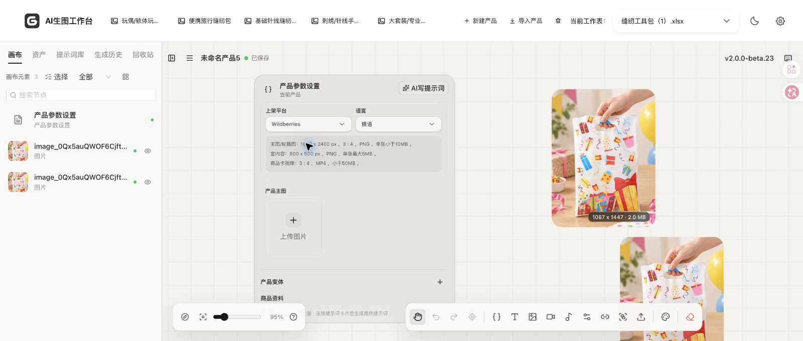

# 商品视觉策划接入验收

日期：2026-11-04

## 实现

- `商品视觉策划指令.ts` 原样采用用户最后提供的平台无关角色；序列化、中英对照和变体输出约定单独维护。
- 平台、文字语言和所选平台规则放入任务消息；制作要求直接采用平台规则，不再提供重复的“本次制作要求”输入。目前只有 Wildberries 配置了规则，其他平台不继承这些规格，待后续补充。
- 移除共用资料与变体资料中的“使用的生图工具”输入。旧数据中的该字段及“本次制作要求”不再参与 AI 策划、生成约束和资料指纹计算。
- 移除人工轮播图张数输入；AI 按商品事实规划图片类型、数量、顺序、用途与统一风格。关键事实不足时可返回待确认项，不清空既有方案。
- 输出整套概览及每张图片的买家问题、依据、构图、完整英文提示词、中文对照、禁止改动项、文案排版和人工检查要点。
- 中文编辑后延迟自动翻译；迟到译文不能覆盖新编辑。翻译未同步、资料已变更或旧方案退休时，生成预检拒绝提交。
- 变体使用独有照片与共用照片，以及各自完整英文提示词。重新策划保留手工修改，并让替代前的配置退出批量入口。
- 任务保存及结果回执沿用当前工作台文本请求和 SQLite 确认链路；可取消请求，保存失败给出明确反馈。

## 自动验证

以下套件分别计数，存在交集，不相加作为独立用例总数：

| 检查 | 结果 |
| --- | --- |
| `npm run test:product-parameters` | 82 通过，0 失败，0 跳过 |
| `npm run test:concurrent-generation` | 82 通过，0 失败，0 跳过 |
| `npm run test:boundaries` | 293 通过，0 失败，0 跳过 |
| 有界 TypeScript `--noEmit` | 通过 |
| `npm run check:ux` | 通过，无检查问题 |
| `npm run dev:check-source` | 通过，开发源与装配一致 |
| 既有开发服务增量构建 | 成功，使用已有 3000 服务 |

回归夹具跟随真实商品生成入口加载变体与英文提示词模块；排布测试通过 TypeScript AST 提取真实执行回调及变体入口，不再依赖旧函数签名的字符串切片。模型端口使用本地样本，断言仍覆盖并发、排布、最终保存失败与只重试保存。

## 浏览器验证

在现有 Chrome 工作台和现有产品上验证：

1. AI 写提示词按钮已可用；缺少产品主图时明确提示补充，不发出模型请求。
2. 参数卡不再显示“使用的生图工具”及“本次制作要求”输入，也没有人工轮播图张数输入。
3. 切换亚马逊时不显示 Wildberries 规则；恢复 Wildberries 后三条既有规则正常显示。回归另覆盖其他平台残留旧 WB 数据时仍不套用 WB 规则。
4. 验证结束后恢复原平台 Wildberries 和语言俄语；刷新后确认“已保存”，两个删除字段未重新出现。
5. 原有节点和图片保留，未上传、删除或生成任何真实素材。

## 验证限制

本轮未向真实上游提交策划、翻译或生图请求，没有产生模型费用。真实模型的策划质量、真实翻译结果及最终生图一致性尚未实测；本地样本与回归通过不代表这些上游结果已经验证。

本次完成开发版接入，未创建版本号、安装包或 GitHub Release。
